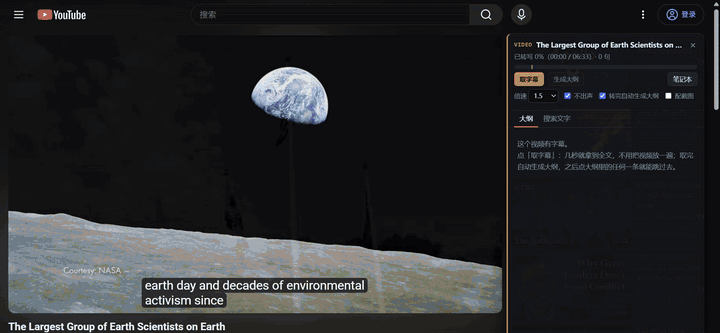

# FrameScribe

**Press a key while watching a video: screenshot + timestamp + a quick note, without pausing. When you're done, let your AI turn it into Markdown notes whose timestamps jump back to the exact second.**

Bilibili · YouTube · course replays · any local player. Grabs subtitles when they exist; transcribes locally when they don't. Uses the Claude Code / Codex subscription you already have, or any API key.

## What it does

| You | FrameScribe |
|---|---|
| `Alt+S` | Grabs the video frame (original quality via the browser extension) and the timestamp |
| `Alt+A` / `Alt+D` | Same, plus a typed note / a spoken note (transcribed on-device) |
| `Alt+L` | "Lecture mode": transcribes whatever your PC is playing, sentence by sentence, on-device |
| "Export & organize" | Your AI reads screenshots + subtitles + your notes and writes a Markdown note with clickable timestamps |

On Bilibili, YouTube, Vimeo and course replays, the 📒 panel grabs subtitles (or transcribes), builds a chapter outline you can click to seek; a YouTube playlist, or every Vimeo/YouTube video embedded in a web page, can be batched into outlines plus an index page.

## Install (Windows 10/11, Chrome or Edge)

1. **Download** this repo (Code → Download ZIP) and unzip it somewhere permanent.
2. **Double-click `setup.cmd`.** It checks/installs Node.js (via winget), installs dependencies, downloads the speech models (~650 MB total the first time), registers the extension bridge and creates a desktop shortcut. Safe to re-run; `setup.cmd -Check` only checks.
3. **Load the extension**: open `chrome://extensions` (or `edge://extensions`), turn on Developer mode, click "Load unpacked" and choose the `extension` folder.

Start **FrameScribe** from the desktop. A first-run screen picks your AI engine and asks where to save notes (an Obsidian vault folder works great).

> **Let your AI install it:** give this repo's URL to Claude Code or Codex and say "install FrameScribe for me". [INSTALL_FOR_AI.md](INSTALL_FOR_AI.md) has the agent-facing steps.

## AI engines

| Engine | Paid by | Notes |
|---|---|---|
| Claude Code | your Claude subscription | runs `claude -p` locally with read-only tools |
| Codex | your ChatGPT subscription | runs `codex exec` in a read-only sandbox |
| API | pay-as-you-go | presets for DeepSeek, Qwen, Kimi, GLM, SiliconFlow, OpenAI, OpenRouter, Anthropic; any OpenAI-compatible URL incl. Ollama |
| Export only | free | just writes the files |

The UI and generated notes are in Chinese; outlines of English videos are written in Chinese with English terms kept.

## Privacy

Everything stays on your machine (`%APPDATA%\FrameScribe` and your export folder). Speech recognition runs locally on the CPU; lecture-mode audio is never saved. Material is sent to an AI only when you click organize.

## License

[PolyForm Noncommercial 1.0.0](LICENSE): free for personal learning, schools and non-profits; you may modify and share it, but **not for any commercial purpose** (no reselling, no paid services). For commercial use, contact the author via an issue. Versions 0.9.0 and earlier were released under GPL-3.0.

Speech models come from [sherpa-onnx](https://github.com/k2-fsa/sherpa-onnx) (SenseVoice, Silero VAD) and are downloaded from their original locations under their own licenses.
